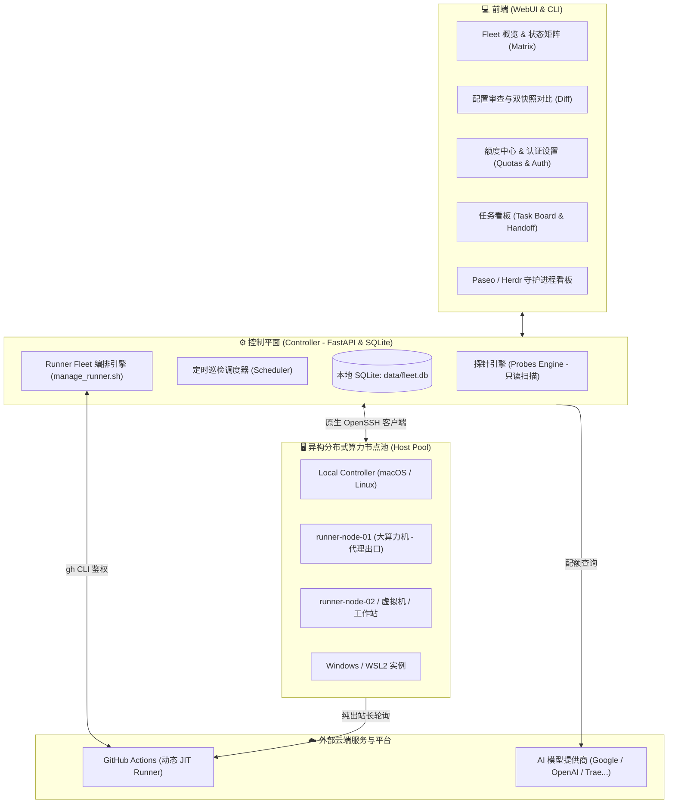

# Agent Fleet WebUI (智能体舰队控制面板)

<p align="center">
  <a href="README.md">English</a> •
  <b>简体中文</b>
</p>

<p align="center">
  跨多机、多平台（macOS / Linux / Windows / WSL）的 AI Coding Agent 全生命周期控制面板与算力协同管理系统。
</p>

---

## 🌟 核心特性概览

- **跨平台多 Agent 深度探测与配置分析**：
  - 支持 **Codex CLI、Claude Code、OpenCode、Pi、Hermes、Antigravity (AGY)、CodeBuddy、Qoder (QoderCN)** 等主流代码智能体。
  - 自动识别并结构化解析系统级、用户级、项目级多层级配置，提供精确的 `resolution`（有效配置生效判定），敏感凭证三层物理脱敏。
- **全局舰队大盘与 Agent 矩阵 (Matrix)**：
  - 矩阵式呈现跨主机与跨 Agent 的安装分布、版本差异、配置漂移与运行健康度。
  - 支持任意两台机器或同一机器不同历史快照间的字段级可视化 Diff 对比。
- **额度查询中心 (Quotas) & 认证配置中心**：
  - 集中监控 Codex、ChatGPT、Antigravity (Google Quota Pools)、QoderCN、Trae CN、WorkBuddy 等平台模型剩余配额、5 小时/周维度使用水位及重置倒计时。
  - 内置**认证配置中心（Auth Settings）**：支持在 WebUI 页面直接查看与更新 Antigravity OAuth Client Secrets，采用 0600 权限原子落盘与严格掩码脱敏，杜绝私钥泄漏。
  - 支持只读关联 Magpie 账号凭据，以及 Trae 凭据自动化定时续期同步。
- **任务看板 (Task Board) & 跨机 Agent Handoff 调度**：
  - 统一看板管理编程任务流，支持关联已有会话并一键向远端机器的 Claude Code / Codex 无缝交接启动工作目录。
- **服务监控 (Daemons & Supervisors)**：
  - 实时透视各节点上 **Paseo** 与 **Herdr** 守护进程状态、监听端口、工作区及 Agent 会话。
- **声明式 GitHub Actions Runner Fleet 编排**：
  - 基于统一的 `config/runner_fleet.yaml` 声明式清单，一键将内网算力节点（如 `runner-node-01`、`runner-node-02` 等）池化为 GitHub Actions 执行节点。
  - **纯出站安全（Outbound Only）**：Runner 仅主动向 GitHub 长轮询任务，**对公网 0 端口暴露**，极致安全。
  - **集中出站代理共享**：支持各节点共享中心节点的 Tailscale SOCKS5（`100.64.0.1:1080`）或内网 HTTP 代理出口。
  - 提供 `overview`（全网大盘）、`sync`（声明式一键自愈对齐）与 `prune`（失联僵尸 Runner 自动清理）。

---

## 🏗 系统架构拓扑



---

## 🚀 快速上手

### 环境准备
- **后端**：Python 3.11+（推荐并经过完整测试的为 Python 3.13），操作系统自带原生 `ssh` 客户端
- **前端**：Node 20+，npm

---

### 1. 一键启动 (推荐)

在项目根目录下直接运行：

```bash
# 生产集成模式：自动同步 venv 环境、编译前端 dist，并由 FastAPI 单进程统一托管
./start.sh

# 启动并自动在默认浏览器中打开页面：
./start.sh --open

# 开发者全量热重载模式：Vite 前端 (:5173) + FastAPI 后端 (:8000) 并发运行
./dev.sh
```

**`./start.sh` 常用参数**：
- `--port <num>`: 自定义后端端口（默认：8000）。
- `--open`: 服务就绪后自动启动浏览器。
- `--dev`: 进入开发热更新模式。
- `--build`: 强制重新编译前端静态资源包。
- `--frontend-host <ip>`: 开发模式下 Vite 绑定的监听地址（默认自动绑定 Tailscale IP，以便在内网私有设备如手机、平板上通过 Tailnet 直接访问，同时对局域网保持隔离）。

---

### 2. Docker 快速部署

使用 Docker Compose 一键启动完整服务：

```bash
docker compose up -d
```

启动后直接访问 `http://localhost:8000`。容器内特性：
- 采用多阶段构建，单容器集成托管已编译的前端 React 应用与 FastAPI 后端。
- 自动将 `./data` 挂载至 `/app/data` 实现 SQLite 数据库与任务状态持久化。
- 默认将宿主机 `~/.ssh` 以只读方式挂载（`/root/.ssh:ro`），使控制器无缝复用已有 SSH 密钥安全探测远端节点。

---

### 3. 手动分步启动

```bash
# 1. 激活虚拟环境并安装依赖 (Python 3.11+; 推荐 3.13)
cd backend
uv venv ../.venv --python 3.13   # 或: python3 -m venv ../.venv
uv pip install --python ../.venv/bin/python -r requirements.txt

# 2. 启动 FastAPI 后端服务
../.venv/bin/python -m uvicorn agent_fleet.main:app --host 127.0.0.1 --port 8000

# 3. 编译并启动前端
cd ../web
npm install
npm run build      # 静态产物输出至 web/dist
npm run dev        # 开发者热重载模式
```

> **提示**：通过 `./start.sh` 或启动后端服务时，系统会自动完成 SQLite 数据库初始化、历史清单迁移以及本机 Controller 探测，无需在启动前手动运行 CLI 预先同步。启动后直接访问 `http://127.0.0.1:8000` 并在界面点击 **Scan all** 即可。
> 如需无头模式命令行调试，可随时执行：`PYTHONPATH=backend .venv/bin/python -m agent_fleet.cli --help`。

---

## ⚙️ 环境配置 (.env 与环境变量)

Agent Fleet 支持开箱即用的配置方式，可在项目根目录下创建 `.env` 文件或直接配置系统环境变量。可复制模板快速初始化：

```bash
cp .env.example .env
```

服务启动时会自动加载 `.env` 中所有以 `AGENT_FLEET_` 开头的配置项。系统环境变量优先级高于 `.env` 文件。

| 环境变量 | 默认值 | 说明 |
| --- | --- | --- |
| `AGENT_FLEET_HOST` | `127.0.0.1` | FastAPI 后端服务监听地址 |
| `AGENT_FLEET_PORT` | `8000` | FastAPI 后端服务 HTTP 端口 |
| `AGENT_FLEET_DATA_DIR` | `data` | 运行时数据存储目录 (数据库、配额凭据、日志) |
| `AGENT_FLEET_DB_PATH` | `<repo>/data/fleet.db` | SQLite 数据库文件绝对/相对路径 |
| `AGENT_FLEET_INVENTORY_PATHS` | `["<repo>/inventory.yaml"]` | 主机清单路径列表 (支持逗号分隔或 JSON 数组) |
| `AGENT_FLEET_API_SECRET` | 空 (None) | 可选 API 访问控制令牌 / Bearer Secret |
| `AGENT_FLEET_ALLOW_ANONYMOUS_READONLY` | `true` | 设置 Secret 后是否依然允许只读匿名访问 (严格模式设为 `false`) |
| `AGENT_FLEET_AUTO_SCAN_ENABLED` | `false` | 启动时是否自动开启后台周期性扫描调度器 |
| `AGENT_FLEET_AUTO_SCAN_INTERVAL_MINUTES` | `60` | 自动定时巡检扫描间隔 (分钟) |
| `AGENT_FLEET_SCAN_CONCURRENCY` | `4` | 探测扫描并发度 (最大硬上限 8) |
| `AGENT_FLEET_COMMAND_TIMEOUT` | `25` | 单项探针执行超时时间 (秒) |
| `AGENT_FLEET_SSH_CONNECT_TIMEOUT` | `10` | SSH 建立连接超时时间 (秒) |
| `AGENT_FLEET_SCAN_TTL_SECONDS` | `21600` | 快照过期陈旧时间 (默认 6 小时) |
| `AGENT_FLEET_INCLUDE_LOCAL_RUNTIME` | `true` | 是否同时探测控制器本机 Runtime 环境 |
| `AGENT_FLEET_LOCAL_HOST_LABEL` | `local-controller` | 控制器本机在资产清单中的显示名称 |

---

## 📖 核心功能与使用指南

### 1. 机器资产管理 (Inventory)
- 舰队的主机列表**完全由清单文件显式定义**，不盲目读取全量 `~/.ssh/config`，杜绝无关主机干扰。
- 支持多路径清单合并：支持标准 Ansible YAML/INI 格式及原生 `inventory.yaml`。
- 支持在 WebUI 设置中心在线编辑与热保存 `inventory.yaml`，即改即生效。

### 2. 额度中心 (Quotas) 与认证配置中心
- 打开 **Quotas** 页面可实时查看各平台额度使用水位、5小时/周限额及重置时间。
- 点击顶部 **⚙️ 认证配置 (Auth Settings)** 按钮：
  - 直观查看各 Antigravity Client ID 的就绪状态（来自环境变量 / 配置文件 / 未配置）；
  - 在线输入或更新 Client Secret，系统自动以 `0600` 权限安全写入 `data/antigravity_clients.json`；
  - 界面与 API 仅展示掩码（如 `GOCSPX-***...***`），杜绝明文凭据通过网络下发。

### 3. 声明式 GitHub Actions Runner Fleet 编排
面对多台异构物理机/虚拟机及多个个人 GitHub 仓库，项目提供了无需引入沉重 K8s 即可落地的声明式管理方案：

1. **配置文件**：[`config/runner_fleet.yaml`](config/runner_fleet.yaml)
   ```yaml
   hosts:
     runner-node-01:
       user: "devuser"
       proxy: "http://127.0.0.1:8118"
       labels: ["self-hosted", "Linux", "X64", "runner-node-01"]
       max_runners: 6

     runner-node-02:
       user: "devuser"
       proxy: "socks5://100.64.0.1:1080"  # 复用代理出口
       labels: ["self-hosted", "Linux", "X64", "runner-node-02"]
       max_runners: 2

   pools:
     sample-org/sample-repo:
       - runner-node-01
       - runner-node-02
   ```

2. **常用管理命令**：
   ```bash
   # 全网全局大盘（跨所有仓库与主机的实时在线/离线/繁忙状态）
   ./scripts/manage_runner.sh overview

   # 一键声明式对齐与自愈（按 yaml 声明补齐缺失节点、重新唤醒异常节点）
   ./scripts/manage_runner.sh sync

   # 一键垃圾回收（批量注销各仓库中失联的 offline 僵尸 Runner）
   ./scripts/manage_runner.sh prune
   ```

---

## 🔒 安全性设计与凭证防泄露

系统在架构上贯彻最高级别的安全边界：

1. **探针扫描纯只读**：
   - 机器探针扫描仅收集版本、模型名、MCP 与配置生效范围，严禁修改任何远端配置。
   - 严格的黑名单过滤：`.ssh/`、各类私钥、`.aws/credentials`、`.npmrc`、`.kube/config`、`/etc/shadow` 等均在探针底层被硬编码拒绝读取。
2. **三层脱敏与无凭据持久化**：
   - 远程机器的原始配置文件仅在内存分析时短暂驻留，落盘数据库与 API 返回结构均经过字段白名单过滤、敏感 Key 递归移除及模式掩码脱敏。
   - 导入的配额凭证存放在 `data/quota_accounts.json`（`0600` 权限），API 绝不返回明文秘钥。
3. **网络通信与接口安全**：
   - 默认模式下 API 面向本地回环（Loopback）免密开放，适合本机开发。
   - 当服务需暴露或共享至局域网/Tailnet 时，可通过配置 `AGENT_FLEET_API_SECRET` 启用 Bearer Token 访问控制（并可通过 `AGENT_FLEET_ALLOW_ANONYMOUS_READONLY=false` 开启全站严格认证）。
   - Runner 仅通过长轮询出站，内网主机无需对外开放任何端口，杜绝网络攻击面。

---

## 🏛️ 系统架构与数据建模

系统采用单进程、轻量级异步架构，基于 SQLite 统一收敛全部核心状态与配置真理源。详细架构与实体模型请参阅文档：

- 📐 **[系统分层架构设计](docs/architecture.md)**：数据流向、探针协议通信、纯函数适配器模式与故障隔离。
- 🗄️ **[系统领域建模与 E-R 实体关系](docs/domain-models.md)**：包含覆盖全部 11 张 SQLite 核心表的 Mermaid E-R 关系图、数据字典、三大业务状态机（Agent 安装、探针采集、任务流转）及面向未来的五大扩展性契约。
- ⚡ **[Runner Fleet 算力调度运维指南](docs/runner-fleet-guide.md)**：多机长轮询出站、代理共享与多仓库池矩阵。
- 📑 **[文档索引中心](docs/README.md)**：项目设计规范、需求与调研全景汇总。

---

## 🧪 自动化测试与质量门禁

项目配备了完善的测试套件与持续集成体系：

```bash
# 激活虚拟环境或设置 PYTHONPATH
export PYTHONPATH=backend

# 运行全量单元测试 (支持多核并发加速)
.venv/bin/python -m pytest tests/ -n auto --dist=loadscope

# 前端静态类型检查
cd web && npm run typecheck

# 前端生产打包构建验证
cd web && npm run build
```

---

## 📂 项目工程结构

```text
├── backend/agent_fleet/        # 后端核心包 (FastAPI 路由、适配器、探针、服务层)
│   ├── adapters/              # 各 AI Agent 的专属探测解析适配器
│   ├── api/                   # RESTful API 路由 (探针、配额、设置中心、工作板)
│   └── services/              # 扫描引擎、调度器、SSH 客户端、配额同步服务
├── web/                       # 前端源码 (React 18, TypeScript, Vite)
│   ├── src/views/             # 页面视图 (Fleet, Matrix, Inspector, Quotas, Tasks, Daemons)
│   └── src/components/        # 核心 UI 组件与设置弹窗
├── config/                    # 声明式配置文件 (runner_fleet.yaml 等)
├── scripts/                   # 运维工具 (manage_runner.sh, teardown_runner.sh 等)
├── tests/                     # 单元测试与集成测试套件 (426+ 测试用例)
├── docs/                      # 架构设计、调研与需求文档
├── inventory.yaml             # 主机资产清单
├── start.sh                   # 单进程生产启动入口
└── dev.sh                     # 开发者并发热重载入口
```

---

## 📄 开源许可证

本项目基于 [MIT License](LICENSE) 开源。
