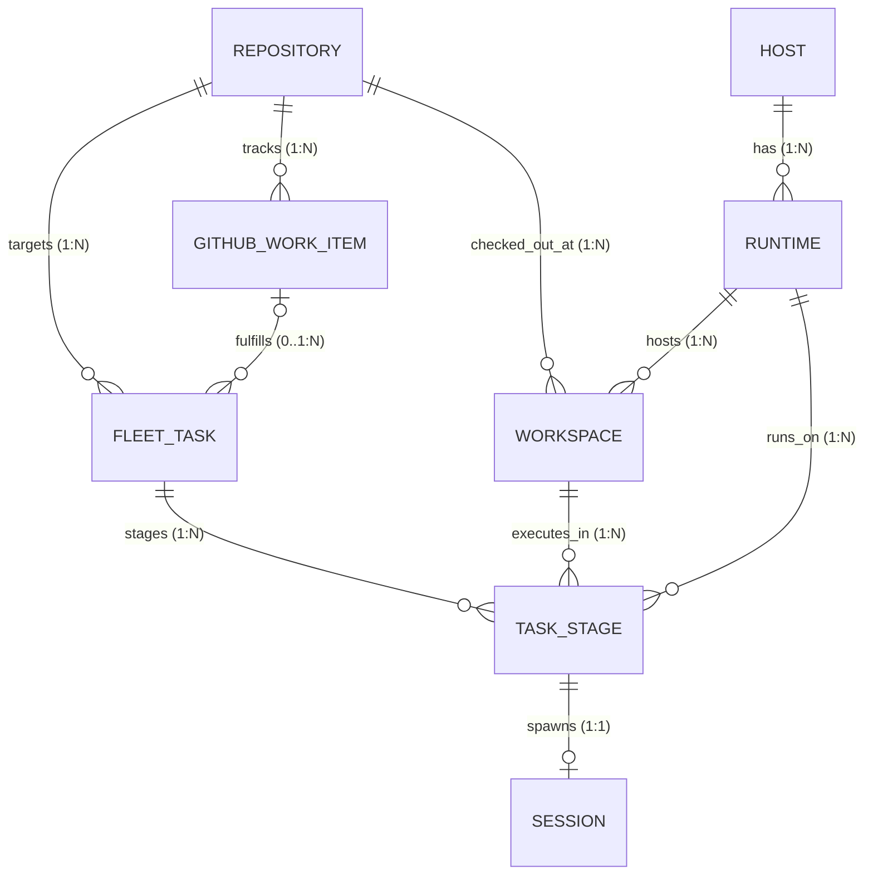

# ADR 0002: 明确 Workspace/Repository 与 AgentExecution 实体边界，建立跨机任务身份与外部事实源契约

- **状态 (Status)**: 已采纳 (Accepted)
- **日期 (Date)**: 2026-10-29
- **决策者 (Deciders)**: 架构委员会 (Architecture Guild) / Agent Fleet 核心团队
- **关联 Issue**: [coolxll/agent-fleet-webui#26](https://github.com/coolxll/agent-fleet-webui/issues/26), [coolxll/agent-fleet-webui#17](https://github.com/coolxll/agent-fleet-webui/issues/17)

---

## 1. 背景与问题陈述 (Context & Problem Statement)

在 Agent Fleet WebUI 当前的实现（详见 `backend/agent_fleet/task_models.py` 及 `docs/domain-models.md`）中，协同任务与执行阶段的模型设计高度简化：
1. `FleetTask` 与 `TaskStage` 均直接包含纯文本字段 `project_path`，`TaskStage` 中还包含纯文本 `host_name`；
2. 在跨机器接力逻辑（`backend/agent_fleet/services/task_service.py::preview_handoff`）中，系统仅凭远端执行一段短 Python 脚本探测目标路径是否存在、读取 `git rev-parse HEAD` 和 `git status --short`，缺少针对代码仓库与工作空间的结构化身份识别与元数据记录；
3. **根本矛盾**：
   - **一仓多机多工作区**：一个逻辑 Git 代码仓库（如 `coolxll/agent-fleet-webui`）可同时存在于开发机、构建机、测试机等多个节点，且在单机上可能通过 `git worktree` 并行检出多个工作目录（如主工作区 `~/workspace/projects/repo` 与任务工作区 `~/workspace/worktrees/repo/task-a`）。同一物理路径在不同机器上指向完全不同的环境，而同一机器上的不同路径可能共享同一个 Git 仓库元数据；
   - **缺乏 Provenance（执行血缘）**：单次 Agent 执行（Execution）在哪个分支、哪个 Commit 基线启动，产生了哪些 Dirty 文件变动，无法结构化追溯；
   - **外部工作流事实源混淆**：伴随 Issue #17 引入 GitHub Issues、PR 与 GitHub Actions 看板，如果直接把 GitHub Issue 当成本地执行任务的主键，会导致本地多机执行尝试、会话分支与外部发布状态产生边界冲突。

为了支持跨机协同可靠流转、杜绝跨机身份与路径混用，必须从领域驱动设计（DDD）层面正式划定核心实体边界，规范身份标识（Identity）、可变性（Mutability）与事实源（Source of Truth）。

---

## 2. 决策驱动因素 (Decision Drivers)

1. **唯一性与可追溯性**：代码执行环境必须具备全局确定性，不可仅由零散的路径字符串弱绑定。
2. **多机异构与 Worktree 原生支持**：原生兼容主检出（Main Worktree）、独立克隆（Standalone Clone）及临时隔离检出（Linked Worktree）。
3. **事实源清晰单向流转**：明确 GitHub 外部事实（Issues/PRs/Workflows）与 Fleet 本地执行事实（Tasks/Executions/Sessions）的边界。
4. **渐进演进与向后兼容**：不破坏既有任务运行能力，保障历史 `project_path` 兼容与平滑迁移。

---

## 3. 核心领域实体定义与基数关系 (Entity Definitions & Cardinality)

系统将核心对象解耦为六大一等公民实体：



### 3.1 实体规范说明

| 实体名称 | 领域职责 | 身份标识 (Identity) | 关键不可变属性 | 关键可变状态属性 |
| :--- | :--- | :--- | :--- | :--- |
| **`Repository`** | 逻辑代码资产与版本控制根基 | `id` (如 `repo_x7f2` 或 Canonical Slug `coolxll/agent-fleet-webui`) | `canonical_name`, `remote_url`, `vcs_type` | `default_branch`, `description`, `is_tracked` |
| **`Workspace`** (Checkout) | 特定机器/运行时上的物理检出目录 | `id` (UUID) 或复合自然键 `(runtime_id, path)` | `host_id`, `runtime_id`, `path`, `worktree_mode` | `current_branch`, `head_commit`, `is_dirty`, `status`, `last_inspected_at` |
| **`FleetTask`** | 用户交付目标意图与编排流水线 | `id` (UUID) | `created_at`, `repository_id` | `title`, `goal`, `status`, `github_work_item_id`, `updated_at` |
| **`TaskStage`** (AgentExecution) | 特定工作空间上的单次执行尝试 | `id` (UUID) | `task_id`, `workspace_id`, `runtime_id`, `agent_id`, `started_at` | `status`, `active_task_id` (互斥锁), `head_commit_before`, `head_commit_after`, `is_dirty_after`, `output`, `error` |
| **`Session`** | Agent 对话历史与工具交互转录 | `id` (UUID) 或 `(runtime_id, agent_id, session_key)` | `runtime_id`, `agent_id`, `session_key` | `message_count`, `token_count`, `summary`, `last_synced_at` |
| **`GitHubWorkItem`** | 外部平台工作项事实源的只读投影 | `id` (如 `gh_issue_coolxll_agent-fleet-webui_26`) | `repository_id`, `item_type`, `number`, `external_id` | `title`, `state`, `labels`, `url`, `author`, `synced_at` |

---

## 4. 身份不可变性与状态可变性规则 (Mutability & Lifecycle)

### 4.1 Repository 规则
- `remote_url`（如 `git@github.com:coolxll/agent-fleet-webui.git`）及规范化名称为全局唯一锚点；
- 一个 Repository 可映射跨多台物理机、多个运行时的多个 Workspaces；
- 不允许使用主机绝对路径代替 Repository 标识。

### 4.2 Workspace 规则
- **物理对应**：唯一对应指定 `runtime_id` 下的一个文件系统目录绝对路径（`path`）；
- **Worktree 模式**：
  - `main_worktree`：主克隆仓的工作目录（含 `.git/` 真实目录）；
  - `linked_worktree`：通过 `git worktree add` 衍生的副工作区（`.git` 为指向主目录文件的指针）；
  - `standalone_clone`：完全独立克隆的仓库；
- **健康度与不可达处理**：
  - 当所在宿主机离线或 SSH 超时，Workspace 状态置为 `unreachable`，保留其最近已知（`last_inspected_at`）的 `head_commit` 与 `branch`，绝不清空数据；
  - 若路径在宿主机被物理删除，状态标记为 `missing`，终止后续执行派发。

### 4.3 TaskStage / AgentExecution 规则
- 一次 Agent 执行只能发生在一个且仅一个确定的 `Workspace` 内；
- **执行基线锁定**：执行启动前必须记录 `head_commit_before`；执行结束后收集 `head_commit_after` 以及变更产物状态（`is_dirty_after`）；
- **执行互斥锁**：沿用 `active_task_id` 唯一约束，保证单 Workspace 上的单任务在任意时刻至多只有一个正在执行的进程；
- **会话血缘**：执行派生或复用 `Session`，并将转录证据挂载于当前 Stage，形成完整审阅链（Review Handoff）。

---

## 5. 事实源原则：单向与双向边界 (Source of Truth Boundaries)

为配合 GitHub 驱动的研发流程看板（Issue #17），明确系统事实源划分：

```
+-------------------------------------------------------------------------+
|                        GitHub (权威外部事实源)                           |
|  - Issue 状态 (Open / Closed)                                           |
|  - Pull Request 状态 (Open / Merged / Closed, Target Branch)            |
|  - GitHub Actions Workflow Run 状态 (Queued / In-Progress / Success)    |
+-------------------------------------------------------------------------+
                                    │ (只读聚合 / 定时同步 / 触发式探查)
                                    ▼
+-------------------------------------------------------------------------+
|                  GitHubWorkItem (本地只读投影缓存表)                     |
+-------------------------------------------------------------------------+
                                    ▲
                                    │ (绑定意图意向关联)
                                    ▼
+-------------------------------------------------------------------------+
|                 FleetTask & TaskStage (本地唯一事实源)                  |
|  - 任务目标与阶段流转 (Todo -> Starting -> Running -> Review -> Done)     |
|  - 执行调度互斥锁 (active_task_id)                                       |
|  - 跨机分发与接力上下文 (Prompt Context, Preview Hash)                  |
+-------------------------------------------------------------------------+
                                    │ (派发至工作区执行)
                                    ▼
+-------------------------------------------------------------------------+
|              Workspace & Agent Session (节点运行层事实)                 |
|  - 本地 Git Worktree、Branch、Commit SHA、Dirty 状态                     |
|  - Agent 进程 Session Transcript 与脱敏后的工具调用证据                  |
+-------------------------------------------------------------------------+
```

### 5.1 单向规则 (GitHub -> Fleet)
1. **工作项生命周期权威在 GitHub**：GitHub Issue 与 PR 的关闭、合并、标签变更属于外部事实。Fleet WebUI 的 `github_work_items` 表仅作为聚合投影缓存，绝不绕过 GitHub 凭据在本地私自伪造完成状态；
2. **状态感知触发**：通过 Controller 端只读调用 `gh` CLI 或 GitHub REST API 定时拉取。

### 5.2 本地权威规则 (Fleet -> Local Execution)
1. **任务编排与执行锁定在 Fleet**：`FleetTask` 的拆解、`TaskStage` 的执行进度、跨机器接力指令（Prompt 与 上下文传递）、`active_task_id` 进程锁，权威完全属于本地 `fleet.db`；
2. **代码交付契约闭环**：Agent 在本地 Workspace 完成代码修改后，遵循 `AGENTS.md` 规范开辟分支、提交 PR 并在 PR Body 中通过语义关键语句（如 `Closes #N`）关联外部 Issue。当 PR 在远端合并且 GitHub 回传关闭信号后，Fleet 关联看板自动完成端到端闭环。

---

## 6. 平滑迁移与向后兼容策略 (Migration & Backward Compatibility)

现有生产库中已存在 `fleet_tasks.project_path`、`task_stages.project_path` 以及 `task_stages.host_name` 文本列。迁移分为三个阶段：

### 阶段 0：现状（当前基线）
- 业务逻辑依赖 `data['project_path']` 字符串定位远端目录，无 `Workspace` 与 `Repository` 实体表。

### 阶段 1：增量元数据扩充与双写过渡（本决策确立目标）
1. **结构增量注入**：
   - 新建 `repositories` 与 `workspaces` 表；
   - 在 `fleet_tasks` 新增 `repository_id` (可空)、`target_workspace_id` (可空)、`github_work_item_id` (可空)；
   - 在 `task_stages` 新增 `workspace_id` (可空)、`head_commit_before` (可空)、`head_commit_after` (可空)；
2. **透明解析与双写**：
   - 当调用 `preview_handoff` 或 `start_handoff` 时，若前端仅传递旧版 `project_path` 与 `runtime_id`，后端服务执行 **“JIT Workspace Discovery”**：
     - 若该路径已登记对应 `Workspace`，则复用其 `id`；
     - 若未登记，自动通过远端探针执行 `git rev-parse --show-toplevel` 与 `git config --get remote.origin.url` 动态发现，并在数据库自动登记 `Repository` 与 `Workspace` 记录，随后回填 `task_stages.workspace_id`；
   - 保留 `task_stages.project_path` 与 `task_stages.host_name` 的写入（双写策略），保证旧版前端界面及未更新的报表查询完全不受影响。

### 阶段 2：全面基于实体调度（未来规划）
- 任务派发 API 强制要求传递 `workspace_id`；废弃裸路径字符串直接派发；
- 将历史数据中 `workspace_id` 为空的阶段记录全量打标或离线归一化补全。

---

## 7. 数据结构详细契约 (Schema Specifications)

### 7.1 新增/扩展实体 DDL 契约

```sql
-- 1. 逻辑仓库表
CREATE TABLE IF NOT EXISTS repositories (
    id VARCHAR PRIMARY KEY,
    canonical_name VARCHAR NOT NULL UNIQUE, -- 如 "coolxll/agent-fleet-webui"
    remote_url VARCHAR NOT NULL,             -- 如 "https://github.com/coolxll/agent-fleet-webui.git"
    default_branch VARCHAR DEFAULT 'main',
    vcs_type VARCHAR DEFAULT 'git',
    description TEXT DEFAULT '',
    is_tracked BOOLEAN DEFAULT 1,
    created_at DATETIME DEFAULT CURRENT_TIMESTAMP,
    updated_at DATETIME DEFAULT CURRENT_TIMESTAMP
);

-- 2. 物理工作空间检出表
CREATE TABLE IF NOT EXISTS workspaces (
    id VARCHAR PRIMARY KEY,
    repository_id VARCHAR REFERENCES repositories(id) ON DELETE SET NULL,
    host_id VARCHAR NOT NULL REFERENCES hosts(id) ON DELETE CASCADE,
    runtime_id VARCHAR NOT NULL REFERENCES runtimes(id) ON DELETE CASCADE,
    path TEXT NOT NULL,                      -- 远端绝对路径，如 "/home/user/workspace/repo"
    worktree_mode VARCHAR DEFAULT 'main_worktree', -- 'main_worktree' | 'linked_worktree' | 'standalone_clone'
    current_branch VARCHAR DEFAULT '',
    head_commit VARCHAR DEFAULT '',
    is_dirty BOOLEAN DEFAULT 0,
    status VARCHAR DEFAULT 'active',         -- 'active' | 'stale' | 'unreachable' | 'missing'
    last_inspected_at DATETIME,
    inspected_error TEXT,
    created_at DATETIME DEFAULT CURRENT_TIMESTAMP,
    updated_at DATETIME DEFAULT CURRENT_TIMESTAMP,
    CONSTRAINT uq_workspace_runtime_path UNIQUE (runtime_id, path)
);

-- 3. 外部 GitHub 工作项投影表
CREATE TABLE IF NOT EXISTS github_work_items (
    id VARCHAR PRIMARY KEY,                  -- 如 "gh_issue_owner_repo_26"
    repository_id VARCHAR NOT NULL REFERENCES repositories(id) ON DELETE CASCADE,
    item_type VARCHAR NOT NULL,              -- 'issue' | 'pull_request' | 'action_run'
    number INTEGER,                          -- Issue / PR 编号
    external_id VARCHAR,                     -- GitHub Global Node ID / Run ID
    title TEXT NOT NULL,
    state VARCHAR NOT NULL,                  -- 'open' | 'closed' | 'merged' 等
    url TEXT NOT NULL,
    author VARCHAR DEFAULT '',
    labels JSON DEFAULT '[]',
    branch_name VARCHAR,
    head_sha VARCHAR,
    synced_at DATETIME DEFAULT CURRENT_TIMESTAMP
);
```

### 7.2 API 交互数据契约（Preview Handoff 增强）

执行预检响应结构（向后兼容扩展）：

```json
{
  "prompt": "Continue this task in the target working directory...",
  "preview_hash": "a1b2c3d4e5f6...",
  "warnings": [
    "Resumes native session s_123. If resume fails, retry using a new session.",
    "Code and uncommitted changes are not copied between machines."
  ],
  "source_session_id": "session_source_01",
  "resume_session_id": "session_target_02",
  "target_workspace": {
    "workspace_id": "ws_linux_01_feat",
    "repository_name": "coolxll/agent-fleet-webui",
    "host_id": "host-linux-01",
    "runtime_id": "rt_linux_native",
    "path": "/home/user/workspace/projects/agent-fleet-webui",
    "worktree_mode": "main_worktree",
    "current_branch": "feat/issue-26-domain",
    "head_commit": "74cd8ea2435eecbb1e64ee7c878e93a86a64f0e9",
    "is_dirty": true
  },
  "target_git": {
    "exists": true,
    "commit": "74cd8ea2435eecbb1e64ee7c878e93a86a64f0e9",
    "status": " M docs/domain-models.md"
  }
}
```

---

## 8. 拆解实施规划与后续独立 Issue (Subsequent Implementation Issues)

遵循严格闭环原则，本 ADR 拆解出以下两个高内聚、有限范围的后续实施任务：

### 后续 Issue 1: `feat(models): 引入 Repository 与 Workspace 持久化模型及本地工作区发现与状态巡检 API`
- **问题与交付物**：
  - 在 `backend/agent_fleet/models.py` 增补 `Repository` 与 `Workspace` 实体声明；
  - 在 `db.py` 维护兼容迁移补齐字段逻辑；
  - 新增 `GET /api/workspaces` 接口，支持查看各节点已纳管的工作区、当前检出分支、HEAD commit 及 dirty 状态；
- **验收标准**：
  1. SQLite 启动自动建表，字段内省补全无报错；
  2. 提供针对远端 Git 工作区状态扫描的单元测试，支持模拟正常检出、脏工作区及不可达异常；
  3. 类型检查与单元测试 100% 通过。

### 后续 Issue 2: `feat(tasks): TaskStage 执行链路绑定 Workspace 实体与平滑迁移双写逻辑`
- **问题与交付物**：
  - 改造 `task_service.py` 中的 `preview_handoff` 与 `start_handoff`，优先基于 `workspace_id` 寻址；
  - 增加 JIT Workspace 自动注册补全逻辑（兼容传入旧版 `project_path`）；
  - 记录执行前后的 `head_commit_before` 与 `head_commit_after` 审计追踪；
- **验收标准**：
  1. Handoff Preview 响应中返回完整的结构化 `target_workspace` 实体元数据；
  2. 仅提供 `project_path` 的旧任务请求仍能成功完成接力启动，并自动补全 `workspace_id`；
  3. 针对并发执行锁与断网不可达场景具备完整的异常回归测试。

---

## 9. 结果与影响 (Consequences)

### 9.1 正向影响 (Positive)
- **消除歧义**：消除了多机环境下「路径相同但分支代码截然不同」的语义混乱；
- **追溯严谨**：每一次 Agent 阶段执行均精确记录其代码 Commit 基线和文件脏状态，执行审计能力显著提升；
- **架构解耦**：GitHub 看板功能（Issue #17）可纯粹基于 `GitHubWorkItem` 进行轻量化投影，而不必侵入核心调度实体。

### 9.2 潜在代价与注意事项 (Costs & Precautions)
- **探针往返开销**：初次发现工作区时需要执行轻量 Git 命令探查远程 URL 与 Worktree 状态，但由于复用了单一只读通道及探测缓存机制，额外耗时控制在可控范围内（< 300ms）。
- **字段双写**：在迁移过渡期需维持 `project_path` 与 `workspace_id` 双写，待所有组件演进至 Phase 2 后方可安全下线旧文本字段。
