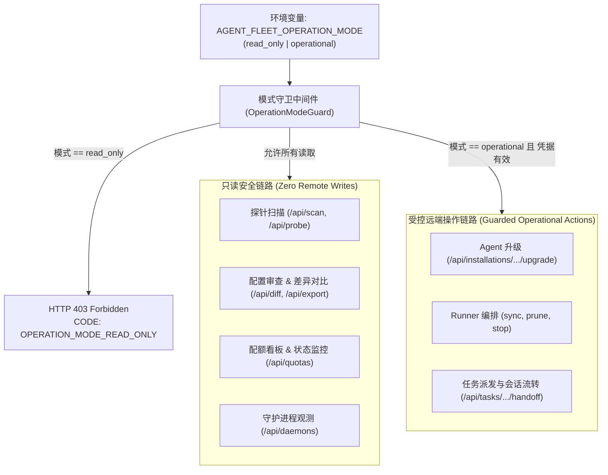

# ADR-001: 规范控制面操作边界与显式运行模式（Read-Only vs Operational Control Modes）

- **状态 (Status)**: 提议中 (Proposed) / 架构设计方案 (Architectural Proposal)
- **日期 (Date)**: 2026-10-29
- **决策者 (Deciders)**: 架构委员会 (Architecture Guild) / Agent Fleet 核心团队
- **关联 Issue**: [coolxll/agent-fleet-webui#63](https://github.com/coolxll/agent-fleet-webui/issues/63), [#49](https://github.com/coolxll/agent-fleet-webui/issues/49), [#50](https://github.com/coolxll/agent-fleet-webui/issues/50), [#51](https://github.com/coolxll/agent-fleet-webui/issues/51), [#52](https://github.com/coolxll/agent-fleet-webui/issues/52), [#53](https://github.com/coolxll/agent-fleet-webui/issues/53)

> [!IMPORTANT]
> **设计状态说明**：本文档为**前瞻性架构设计提案 (Architectural Proposal)**，旨在为系统从早期的“纯只读探测大盘”向“全生命周期受控运维控制面”演进奠定清晰的契约与安全防御体系。文中所述的显式模式切换开关与细粒度权限守卫代表未来的实现目标与架构演进路线，当前代码库通过白名单模板与 `AGENT_FLEET_API_SECRET` 机制提供基础防护。

---

## 1. 背景与问题陈述 (Context & Problem Statement)

Agent Fleet WebUI 项目创立之初（Phase 1），核心定位为**跨节点纯只读观测大盘**（Read-only Fleet Explorer）。其设计哲学建立在非侵入式探针扫描、无状态脚本流传输以及零远端写操作（HC-1）之上，确保即使面对严苛的生产环境或多租户共享主机，运维人员亦可无心理负担地全网扫描。

然而，随着系统能力的不断拓展，真实开发场景对“集中运维与协同调度”产生了强烈的需求，系统陆续引入了三类具备远端写操作或进程生命周期干预的核心功能：
1. **Agent 一键版本升级 (`action_service.py`)**：通过 SSH 在远端节点执行 `npm` 或官方 CLI 自更新脚本（如 `claude update`、`opencode upgrade`、`agy update`），修改远端文件系统全局软件包；
2. **声明式 GitHub Actions Runner Fleet 编排 (`scripts/manage_runner.sh`)**：启停宿主机常驻进程、配置网络代理出口、注册/注销 GitHub 临时 JIT 凭据以及执行孤儿进程清理；
3. **跨机任务看板与 Agent Handoff 调度 (`task_service.py`)**：向远端环境派发编码指令并唤醒 Claude Code 或 Codex 交互会话，直接干预远端代码仓库与 Git 分支工作区。

### 核心矛盾
- **安全契约认知脱节**：早期文档与需求陈述中“只读、不修改远端”的绝对声明，与当前实际支持的写能力之间存在描述性断层，使安全审计人员和终端用户对工具的副作用产生困惑；
- **缺乏系统级写防护开关**：用户无法以声明式配置一键将控制面“锁死”在安全只读模式（例如在对接只读权限节点、安全合规演练或公开只读演示场景下）；
- **权限边界与身份凭证粒度粗放**：当前写操作保护主要依赖 `AGENT_FLEET_API_SECRET` 的有无，缺少在无鉴权本地回环或受限环境下的“操作模式”隔离能力。

---

## 2. 决策驱动因素 (Decision Drivers)

1. **绝对可控的爆炸半径 (Bounded Blast Radius)**：用户必须能够显式声明该实例是否允许执行任何远端修改，杜绝误触升级或误杀进程；
2. **透明的信任模型 (Transparent Trust Boundary)**：清晰划定非侵入探针与受控远端操作的界限，诚实反映系统能力；
3. **渐进式演进与向后兼容 (Backward Compatibility)**：现有本地开发者和现有脚本调用路径在缺省配置下应保持无感，不造成破坏性断裂；
4. **统一的 API 拦截契约 (Uniform API Interception)**：为前端 UI 与后端 REST API 提供统一、可检查的错误码与权限表达。

---

## 3. 提议方案：显式双模控制面 (Proposed Design: Explicit Dual Operational Modes)

提议在未来版本中引入**显式运行模式 (Operation Modes)** 与可选的**细粒度操作特性开关 (Feature Flags)**：



### 3.1 核心配置契约

提议在 `agent_fleet.settings.Settings` 中增加以下配置项：

```python
# 运行模式枚举: 'read_only' (纯只读大盘) 或 'operational' (全功能控制面)
AGENT_FLEET_OPERATION_MODE: str = "operational"  # 缺省兼容现有行为

# 细粒度操作开关 (当 OPERATION_MODE == 'operational' 时生效)
AGENT_FLEET_ENABLE_REMOTE_UPGRADE: bool = True     # 允许一键远程升级
AGENT_FLEET_ENABLE_RUNNER_MGMT: bool = True       # 允许 Runner 编排与启停
AGENT_FLEET_ENABLE_TASK_HANDOFF: bool = True       # 允许 Task Board 远端调度
```

1. **`read_only` 模式**：
   - 系统降级为纯只读大盘；
   - 彻底关闭所有具备远端副作用的路由；
   - 探针扫描、配置解析、差异对比、额度查询与服务状态监控保持 100% 正常运行；
   - 适用于安全合规审计、只读演示环境及高敏感生产堡垒机。
2. **`operational` 模式**：
   - 启用受控写操作链路；
   - 配合 `AGENT_FLEET_API_SECRET` 与 `UPGRADE_RULES` 白名单，提供安全的远程版本管理、Runner 编排与任务流转。

---

## 4. API 边界与拦截契约 (API Boundaries & Guard Contracts)

### 4.1 路由保护修饰器 (Decorator Pattern)

提议在后端引入统一的路由声明修饰器 `@require_operational_mode(capability=...)`：

```python
from fastapi import HTTPException, status

def require_operational_mode(capability: str | None = None):
    async def dependency(settings: Settings = Depends(get_settings)):
        if settings.operation_mode == "read_only":
            raise HTTPException(
                status_code=status.HTTP_403_FORBIDDEN,
                detail={
                    "code": "OPERATION_MODE_READ_ONLY",
                    "message": "This Agent Fleet instance is configured in read-only mode. Remote write operations are disabled.",
                }
            )
        if capability and not getattr(settings, f"enable_{capability}", True):
            raise HTTPException(
                status_code=status.HTTP_403_FORBIDDEN,
                detail={
                    "code": f"CAPABILITY_{capability.upper()}_DISABLED",
                    "message": f"Operational capability '{capability}' is explicitly disabled in server configuration.",
                }
            )
    return Depends(dependency)
```

受保护的路由清单（覆盖现有全部远端写端点）：
- `POST /api/installations/{inst_id}/upgrade`
- `POST /api/upgrades/batch`
- `POST /api/machines/{host_id}/upgrade-all`
- `POST /api/agents/{agent_id}/upgrade-all`
- `POST /api/fleet/upgrade-all`
- `POST /api/tasks/{task_id}/handoff`
- `POST /api/tasks/{task_id}/stages`
- 未来新增的远端文件下发或配置回写路由。

### 4.2 前端感知与 UI 降级

后端在 `/api/state` 或 `/api/auth/status` 元数据接口中下发当前实例的 `operation_mode` 及各能力标志位：
- 前端全局 Header 展示状态 Badge（如 `🛡️ Read-Only Mode`）；
- 升级按钮、Handoff 执行按钮及批量操作入口呈现为禁用（Disabled）状态，并浮动提示：“当前实例处于只读安全模式，写操作已被服务端禁用”；
- 避免前端尝试发起无效请求后再被 403 阻断，提供流畅直观的用户预期。

---

## 5. 安全性考量与信任模型 (Security Considerations)

1. **纵深防御 (Defense in Depth)**：
   - 运行模式（`OPERATION_MODE`）构成**第一道系统级硬防线**；
   - API 令牌认证（`AGENT_FLEET_API_SECRET`）构成**第二道身份鉴权防线**；
   - 命令白名单与参数无关模板（`UPGRADE_RULES`）构成**第三道执行防线**；
   - 目标机用户权限与 OpenSSH 限制构成**第四道基础设施防线**。
2. **审计日志完备性 (Audit Logging)**：
   - 提议在写操作触发时，统一记录结构化审计事件（发起客户端 IP、目标 Runtime、升级/调度对象、前置版本基线、执行耗时及最终 Exit Code）；
   - 在只读模式下拦截的违规调用，同样记录安全预警日志。

---

## 6. 后果与兼容性权衡 (Consequences & Trade-offs)

### 正面收益 (Positive Consequences)
- **概念精确**：彻底消除了文档、规范与真实代码行为之间的语义鸿沟；
- **部署灵活性**：单一代码库可自由适配“敏感集群只读巡检”与“研发环境全自动协同控制面”两大截然不同的业务场景；
- **合规友好**：便于企业安全团队对系统进行风险分级评估与权限纳管。

### 代价与权衡 (Negative / Trade-offs)
- 增加了轻微的配置项复杂度（引入 1 个主模式枚举与 3 个子开关）；
- 前端需要维护基于模式的状态响应与禁用逻辑分支。

### 向后兼容性策略 (Backward Compatibility)
- `AGENT_FLEET_OPERATION_MODE` 默认取值设为 `operational`，确保现有所有开发者的升级工作流、Runner 管理与 Task Board 不受任何阻断；
- 未设置新环境变量的历史部署无缝平滑运行。

---

## 7. 演进路线图 (Roadmap & Implementation Phasing)

- **阶段一 (Phase 1 - 本次 Issue #63 范围)**：
  - [x] 正式校准产品文档、架构说明与需求基线；
  - [x] 发布 ADR-001 架构提案，确立双模运行与 API 拦截契约规范。
- **阶段二 (Phase 2 - 后续迭代实施)**：
  - [ ] 在 `Settings` 中引入 `operation_mode` 及其验证逻辑；
  - [ ] 实现 `@require_operational_mode` 路由依赖并接入 `action_service` 与 `task_service` 端点；
  - [ ] WebUI 增加只读标识横幅与按钮自适应置灰；
  - [ ] 编写全套只读模式拦截与通过性单元测试套件。