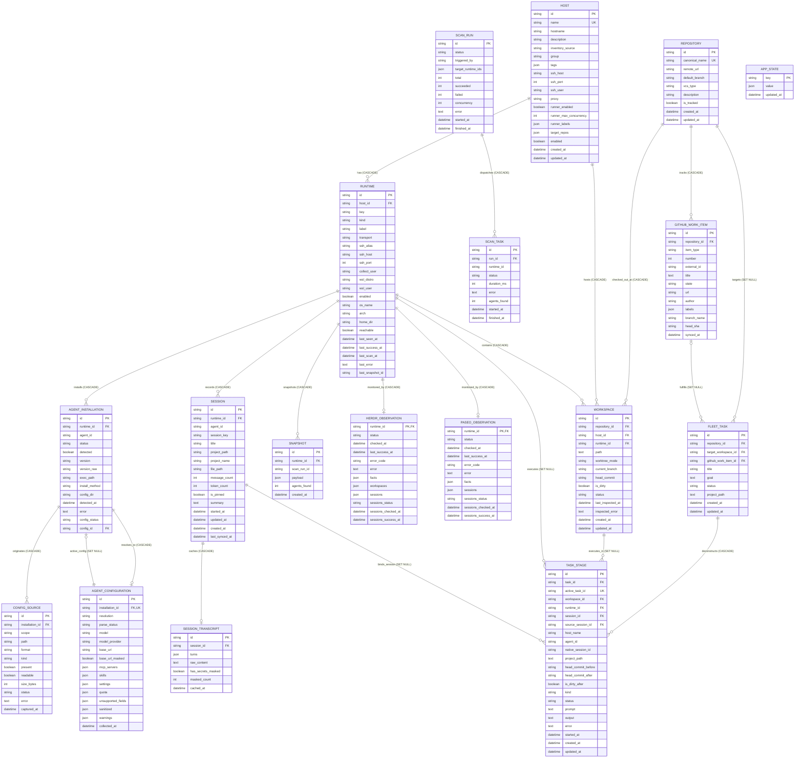
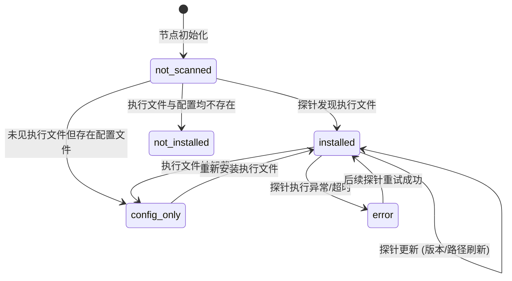
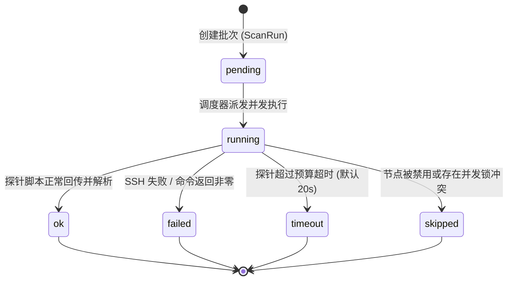
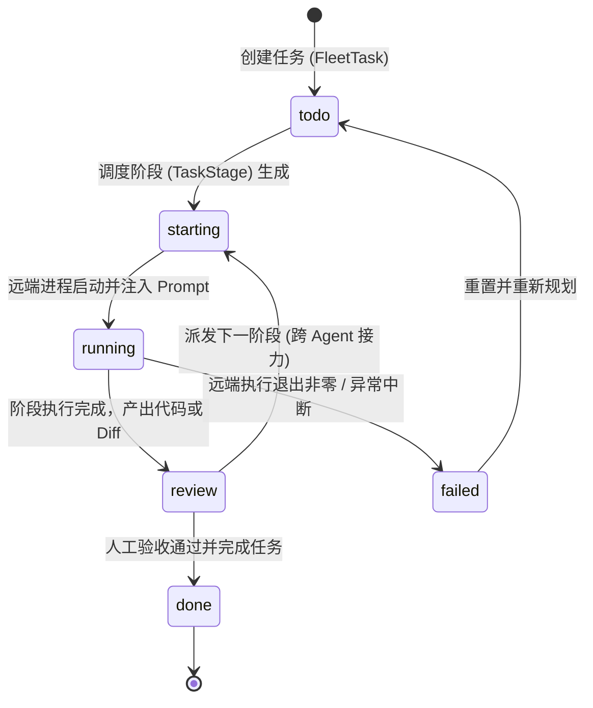
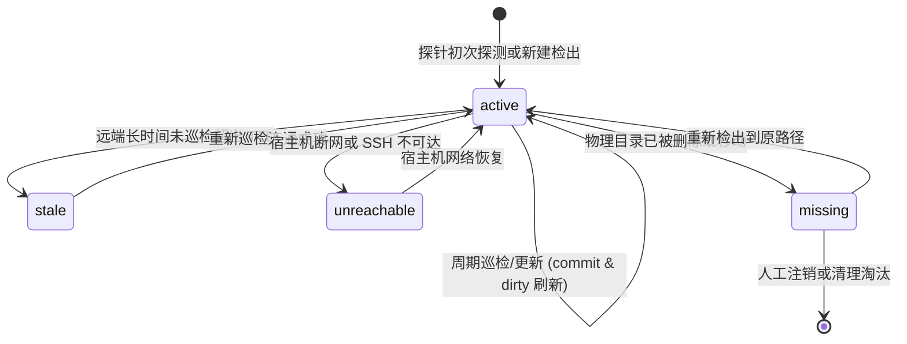

# Agent Fleet WebUI 领域建模与 E-R 实体架构

本文档定义 Agent Fleet WebUI 系统的**统一领域模型（Domain Model）**、**E-R 实体关系（Entity-Relationship Diagram）**、**数据字典**及**架构可扩展性契约**。作为跨机、跨平台 AI Coding Agent 控制面板与 Runner Fleet 纳管系统的全局数据真理源规范。

---

## 1. 领域架构全景 (Domain Architecture Overview)

系统采用单体轻量化、高鲁棒的单进程架构，通过 SQLite (`data/fleet.db`) 统一收敛所有配置、状态与历史快照，配合文件级权限隔离（`data/quota_accounts.json` 0600）保证凭证安全。

领域划分为七大核心子系统：

1. **基础设施与算力纳管域 (Infrastructure & Compute Fleet)**：负责纳管物理机/虚拟机、统一 SSH 连接、出站代理出口配置以及 GitHub Actions Runner Fleet 算力调度池；
2. **代码资产与工作空间域 (Repositories & Workspaces Fleet)**：统一管理逻辑 Git 仓库资产（Repository）、多机分布式检出工作空间（Workspace/Checkout）与 Worktree 状态；
3. **Agent 资产与探测域 (Agent Discovery & Configuration)**：基于只读探针流收集多环境（macOS, Linux, Windows, WSL）上的 Coding Agent 拓扑、版本、多层配置与脱敏结果；
4. **任务编排与协同流转域 (Task Orchestration & Handoff)**：维护开发任务意图（FleetTask）、子执行阶段（TaskStage/AgentExecution）、跨机器/跨 Agent 的执行协同、执行互斥锁与外部平台工作项投影（GitHubWorkItem）；
5. **会话历史与转录域 (Sessions & Sanitized Transcripts)**：纳管各 Agent 原生对话历史、Token/消息计数及严格脱敏后的交互 Turns 缓存；
6. **运行时观测域 (Runtime Daemon Observers)**：无侵入旁路观测 Herdr 和 Paseo 等终端多路复用器的运行状态与工作空间；
7. **凭据隔离与配额域 (Secret-Isolated Quotas)**：以内存及只读视角展示模型提供商 Quota，敏感 Token 绝不入库。

---

## 2. 实体关系图 (E-R Diagram)

以下为系统所有持久化实体及其外键约束（级联删除 / 设空）的完整 Mermaid E-R 图（参见 [ADR 0002](adr/0002-workspace-repository-execution-boundaries.md)）：

---

## 3. 实体字典与设计职责 (Entity Dictionary)

### 3.1 `hosts` (主机资产与配置唯一真理源)
- **定位**：物理机或虚拟宿主机（Node）。在 Phase 1 之后成为系统的单一真理源（Single Source of Truth），取代传统的 `inventory.yaml` 与 `runner_fleet.yaml`。
- **关键属性**：
  - `name`: 唯一业务标识（如 `linux-srv-01`, `win-workstation-01`）；
  - `ssh_host`, `ssh_port`, `ssh_user`: 统一 SSH 连接端点凭据，由 Controller 原生安全调用；
  - `proxy`: 出站统一代理（HTTP/SOCKS5，如 `http://127.0.0.1:8118`），确保本节点上的 Runner 与探针纯出站访问，外部 0 端口暴露；
  - `runner_enabled`, `runner_max_concurrency`, `runner_labels`, `target_repos`: GitHub Actions Runner 编排池属性，定义本节点并发能力与订阅仓库矩阵；
  - `enabled`: 软删除/停用开关，禁用后保留历史扫描快照但排除在日常巡检之外。

### 3.2 `runtimes` (执行运行环境)
- **定位**：宿主机上的具体隔离环境。一个 Host 至少拥有一个 `native` 主运行时；若为 Windows 宿主，还可额外派生多个 WSL 发行版独立运行时。
- **唯一约束**：`uq_runtime_host_key (host_id, key)`。
- **关键属性**：
  - `key`: 环境标识（如 `native`, `Ubuntu-22.04`）；
  - `kind`: `linux`, `darwin`, `windows`, `wsl`；
  - `reachable`, `last_seen_at`, `last_success_at`: 节点健康度与保活心跳。

### 3.3 `agent_installations` & `agent_configurations` (Agent 资产与生效配置)
- **定位**：指定运行时环境下具体 Coding Agent（如 Codex, Claude Code, Trae, Qoder, OpenCode 等）的安装实例与规范化配置。
- **唯一约束与外键契约**：
  - `agent_installations`: `uq_runtime_agent (runtime_id, agent_id)`，外键 `config_id` 指向 `agent_configurations.id (ON DELETE SET NULL)`；
  - `agent_configurations`: 唯一约束 `uq_agent_config_installation_id (installation_id)`，外键 `installation_id` 指向 `agent_installations.id (ON DELETE CASCADE)`。形成强保证的数据库级 1:1 双向完整性约束。
- **关键属性**：
  - `status`: 安装状态（见状态机章节）；
  - `resolution`: `effective`（全层级成功解析）或 `declared`（存在读取降级）；
  - `mcp_servers`, `skills`, `settings`: 严格经过脱敏管道洗白后的结构化配置。

### 3.4 `repositories` (逻辑代码仓库资产)
- **定位**：代码资产的全局逻辑表示，独立于任何单台物理机检出（详见 [ADR 0002](adr/0002-workspace-repository-execution-boundaries.md)）。
- **关键属性**：
  - `canonical_name`: 规范化唯一名称（如 `coolxll/agent-fleet-webui`）；
  - `remote_url`: 远程 Git 地址（如 `https://github.com/coolxll/agent-fleet-webui.git`）；
  - `default_branch`: 默认主干分支（如 `main`）；
  - `is_tracked`: 是否纳入活跃任务编排与看板联动。

### 3.5 `workspaces` (多机物理检出与工作空间)
- **定位**：特定主机/运行时环境中的一个物理 Git 检出目录。一个 Repository 可在多台机器、多个 Worktree 拥有独立的 Workspace。
- **唯一约束**：`uq_workspace_runtime_path (runtime_id, path)`。
- **关键属性**：
  - `worktree_mode`: 检出形态，区分 `main_worktree`（主工作区）、`linked_worktree`（关联派生工作区）与 `standalone_clone`（独立克隆）；
  - `current_branch`: 当前检出的本地分支名；
  - `head_commit`: 40 位 HEAD Commit SHA；
  - `is_dirty`: 工作区是否包含未提交代码变动；
  - `status`: 健康状态（`active` 活跃, `stale` 陈旧, `unreachable` 主机失联, `missing` 路径被删除）。

### 3.6 `github_work_items` (外部平台工作项投影)
- **定位**：GitHub Issues、Pull Requests 与 Actions Workflow Runs 的本地只读聚合投影缓存（配合 Issue #17 流水线看板）。
- **单向事实源原则**：外部事实源绝对以 GitHub 为准，本地仅作只读拉取与状态展示，绝不绕过远程 API 私自篡改生命周期状态。
- **关键属性**：
  - `item_type`: 工作项类别（`issue`, `pull_request`, `action_run`）；
  - `number`: GitHub Issue / PR 编号；
  - `state`: 外部原生生命周期状态（`open`, `closed`, `merged` 等）；
  - `head_sha`: 关联 Commit 或 PR 分支最新 SHA。

### 3.7 `fleet_tasks` & `task_stages` (工作流看板与执行阶段)
- **定位**：持久化用户分配的编码协同任务，支持跨机器、跨 Agent 派发与接力（Handoff）。
- **关键属性**：
  - `repository_id`: 所属代码仓库外键，将交付意图收敛至全局代码资产；
  - `target_workspace_id`: 目标工作空间外键，在派发接力时精确锚定检出环境；
  - `github_work_item_id`: 关联的外部工作项（Issue/PR）投影；
  - `workspace_id`: 单次阶段执行实际绑定的物理工作空间；
  - `active_task_id`: 阶段执行互斥唯一锁。由 SQLite 唯一约束在数据库层面杜绝并发重复触发同一任务；
  - `head_commit_before` & `head_commit_after`: 执行前后的代码 Commit 基线审计快照；
  - `is_dirty_after`: 执行完毕后工作区是否存在未提交变动；
  - `native_session_id`: 绑定到底层 Agent 的原生会话句柄（如 Codex/Claude 会话 ID）；
  - `project_path` & `host_name`: 历史兼容文本快照字段，平滑兼容老版本接口与报表。

### 3.8 `sessions` & `session_transcripts` (会话与转录缓存)
- **定位**：聚合管理各节点的 Agent 会话历史。
- **关键属性**：
  - `session_key`: 原生会话标识符；
  - `has_secrets_masked`, `masked_count`: 脱敏管道统计指标，确保聊天记录中的 API Key、Token 不在 WebUI 或导出中泄漏。

### 3.9 凭证安全隔离层 (`data/quota_accounts.json`)
- **定位**：非数据库存储的安全机密文件（文件权限 `0600`，配合进程内 `threading.RLock` 原子写入）。
- **设计红线**：所有外部 Token（如 GitHub Personal Token, Antigravity 凭证）绝不存入 SQLite，防止数据库导出、备份或快照产生机密外泄。

---

## 4. 核心状态机生命周期 (State Machines & Lifecycles)

### 4.1 Agent 安装状态机 (Installation Lifecycle)

### 4.2 扫描任务执行生命周期 (Scan Task Lifecycle)

### 4.3 任务协同跨机接力 (Task Handoff Lifecycle)

### 4.4 工作空间生命周期状态机 (Workspace Lifecycle)

---

## 5. 系统可扩展性设计契约 (Extensibility Contracts)

为了保证系统在未来引入更多物理节点、异构操作系统、新兴 Coding Agent 以及复杂工作流时能够平滑演进，架构遵循以下六项核心契约：

### 契约 1: 纯函数式 Agent 适配器插件机制 (Functional Adapter Contract)
- **原则**：所有适配器继承 `backend/agent_fleet/adapters/base.py::AgentAdapter`。
- **边界隔离**：适配器绝不直接调用网络或 SSH。探针脚本在远端收集原始记录流（`RemoteFacts`），适配器仅作为**纯函数**执行解析，保证任何新 Agent 可以完全在零网络、离线单测中通过 Fixtures 进行 100% 覆盖率验证。

### 契约 2: 统一出站代理与零公网暴露拓扑 (Zero Inbound Exposure)
- **原则**：任何纳管主机均无需映射公网端口或开放 Ingress 路由。
- **出站统一**：节点可通过 `hosts.proxy` 属性统一出站。无论是 GitHub Actions Runner 还是定时探针，均采用长轮询（Long Polling）与正向出站代理，杜绝内网穿透带来的安全攻击面。

### 契约 3: Runner 算力调度池解耦扩展 (Decoupled Runner Fleet Pools)
- **原则**：算力供给方（Host 节点）与算力消费方（GitHub 仓库）采用 N:M 映射模型。
- **调度解耦**：主机通过 `target_repos` 和 `runner_labels` 声明自身算力服务矩阵。编排脚本 `manage_runner.sh` 优先直连 SQLite 配置表，动态感知节点代理与并发限制，新增机器只需在配置表中轻量登记即可即刻生效。

### 契约 4: 凭据零入库与单向脱敏安全红线 (Strict Secret Hygiene)
- **原则**：
  1. 敏感认证密钥（Tokens, Cookies, Private Keys）永久禁止写入 `fleet.db`；
  2. 探测阶段获取的 raw 内容必须经由 `adapters/sanitize.py` 进行白名单过滤与正则替换（如 `sk-...` 脱敏）；
  3. 即使发生数据库泄露或用户执行快照导出，亦保证无任何明文机密泄漏。

### 契约 5: 数据库自动平滑演进原则 (Zero-Downtime Schema Evolution & Migrations)
- **原则**：结合增量列内省（`_add_missing_columns`）与版本化幂等迁移管道（`run_migrations` / `schema_migrations` / `PRAGMA user_version`）实现数据库平滑自愈与演进。
- **向后兼容与约束演进**：
  1. 新增列场景：实体新增列时声明合理的默认值（Default）与空值容忍（Nullable），系统启动阶段自动执行增量 `ALTER TABLE ADD COLUMN`；
  2. 约束与关系演进场景：对 SQLite 无法直接 ALTER 的约束（如 UNIQUE 约束、FOREIGN KEY、索引重构及历史数据去重清理），通过有序版本迁移器在事务与外键保护下以安全 12 步重建表机制平滑升级，保持历史数据零丢失与多次启动的完全幂等性。

### 契约 6: 多机代码空间与执行血缘确定性契约 (Workspace & Provenance Contract)
- **原则**：根据 [ADR 0002](adr/0002-workspace-repository-execution-boundaries.md)，单次执行（TaskStage / AgentExecution）必须绑定确定的 Workspace 物理检出，严格区分逻辑 Repository 标识与单机路径。
- **状态审计**：执行启动前必须固化记录基线 `head_commit_before`；执行完成后必须收集最新 `head_commit_after` 与 `is_dirty_after`，保证代码变动可追溯、跨机接力不混淆。
- **事实源解耦**：外部 GitHub Issue/PR 状态仅作为 `github_work_items` 单向只读投影，本地任务编排状态与执行互斥锁作为内部唯一事实源。
