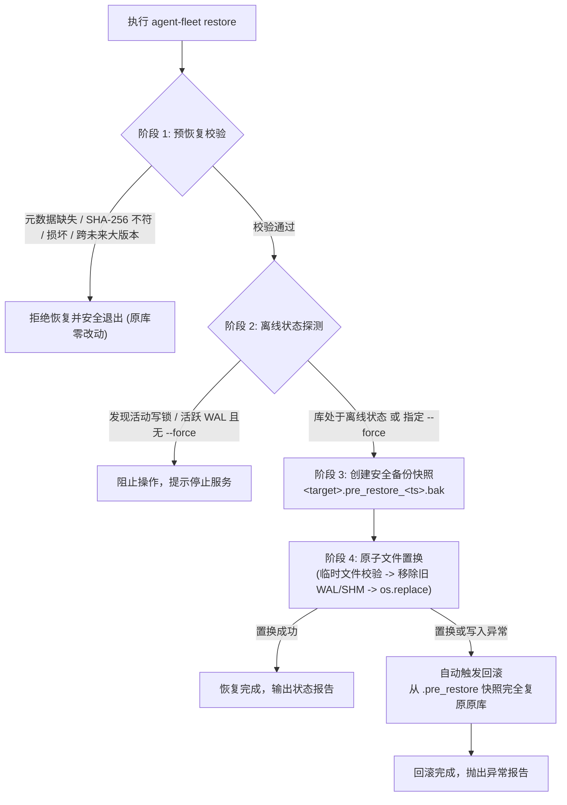

# Agent Fleet - 数据库恢复与升级回退操作指南 (Recovery & Rollback Runbook)

本指南详述 Agent Fleet 系统在版本升级失败、数据损坏或故障应急场景下的**离线数据恢复与降级回退操作流程**，阐述 SQLite 离线恢复服务内部的安全防护机制，并明确非 SQLite 资产的维护边界。

---

## 1. 概述与核心安全机制

Agent Fleet 采用单机 SQLite 作为核心持久化存储（默认路径为 `data/fleet.db`），并在运行时启用 WAL 模式以支撑并发读写。

在升级失败或进行历史版本回滚时，直接覆盖正在运行或带有旧 WAL 事务的 SQLite 数据库极易造成数据损坏与页撕裂（torn pages）。为此，Agent Fleet 实现了**四阶原子安全恢复流程 (Four-Phase Safety Restore Pipeline)**：



### 核心安全准则
1. **强一致性校验**：必须通过 SHA-256 哈希校验与 SQLite `PRAGMA integrity_check`；
2. **模式防倒灌 (Schema Forward-Guard)**：拒绝恢复高版本应用导出的备份（`backup.schema_version > app.max_schema_version`），防止未迁移模式导致运行时崩溃；
3. **前置安全快照**：触碰现有数据库前，强制创建 `<db_name>.pre_restore_<timestamp>.bak`；
4. **防 WAL 污染清理**：在原子替换 `.db` 主文件前，自动隔离并清理目标旧库的 `-wal` 与 `-shm`，杜绝旧日志重放到新恢复库中；
5. **异常自动回退**：恢复过程中若发生任何 I/O、磁盘满或中断异常，自动从安全快照无缝回滚，确保业务数据不处于半写状态。

---

## 2. 升级前备份最佳实践 (Pre-Upgrade Best Practices)

在进行任何代码更新（如 `git pull`）、容器镜像升级或安装新依赖前，**必须首先创建一致性在线备份**：

```bash
# 1. 执行一致性热备份（服务无需停止）
python -m agent_fleet.cli backup

# 预期输出示例：
# {
#   "backup_name": "fleet_backup_20261029_100000.db",
#   "created_at": "2026-10-29T10:00:00.123456+00:00",
#   "app_version": "0.2.0",
#   "schema_version": 1,
#   "sha256": "4f53cda18c2baa0c0354bb5f9a3ecbe5ed12ab4d8e11ba873c2f11161202b945",
#   "file_size_bytes": 147456,
#   "integrity_ok": true,
#   "table_counts": { ... }
# }

# 2. 确认备份文件及同名伴随元数据存在
ls -lh data/backups/fleet_backup_20261029_100000.db*
# 输出包含：
# data/backups/fleet_backup_20261029_100000.db
# data/backups/fleet_backup_20261029_100000.db.meta.json
```

> [!TIP]
> 伴随元数据文件（`.meta.json`）记录了备份时间戳、SHA-256 校验和、模式版本与表行数，是恢复命令核验可信度的必要依据，请务必与 `.db` 备份文件一同妥善保存。

---

## 3. 升级失败后的回退全流程 (Rollback Runbook)

当新版本上线后出现启动崩溃、数据库迁移报错（`MigrationError`）、接口兼容性破裂或异常行为时，请按照以下标准回退流程操作：

### 步骤 1：停止当前所有 Agent Fleet 进程
恢复属于**离线操作**。为防止并发写锁与脏日志，必须先停止服务进程：

```bash
# 若使用部署脚本或后台守护运行：
# 查找并终止 uvicorn / python -m agent_fleet 进程
pkill -f "agent_fleet" || true

# 检查端口或进程是否已彻底退出
ps aux | grep "[a]gent_fleet"
```

### 步骤 2：代码与环境版本回退
将代码仓库回退到升级前稳定提交（或稳定 Tag）：

```bash
# 查看版本提交记录
git log -n 5 --oneline

# 检出升级前的稳定版本（例如 v0.2.0 或指定 commit-hash）
git checkout <PRE_UPGRADE_COMMIT_TAG>

# 重新同步前端构建产物（若涉及静态前端资产）
cd web && npm run build && cd ..
```

### 步骤 3：执行离线数据恢复
调用 `agent-fleet restore` 命令将数据库复原至升级前快照：

```bash
# 运行离线数据恢复命令
python -m agent_fleet.cli restore data/backups/fleet_backup_20261029_100000.db

# 终端将逐步输出各阶段执行状态及最终恢复摘要
```

若原数据库存在非正常断电遗留的未检查点 WAL 文件，但在确认服务已完全关闭的前提下，可附带 `--force` 强制覆盖：
```bash
python -m agent_fleet.cli restore data/backups/fleet_backup_20261029_100000.db --force
```

### 步骤 4：验证数据并重启服务
```bash
# 验证数据库完整性
sqlite3 data/fleet.db "PRAGMA integrity_check;"
# 预期输出: ok

# 启动服务
./start.sh
```

---

## 4. `agent-fleet restore` 命令详解

### 4.1 命令语法与参数

```bash
python -m agent_fleet.cli restore [-h] [--target-db TARGET_DB] [--force] backup_path
```

| 参数 | 默认值 | 说明 |
| :--- | :--- | :--- |
| `backup_path` | *(必填)* | 备份 SQLite 数据库文件路径（例如 `data/backups/fleet_backup_20261029_100000.db`） |
| `--target-db` | `settings.db_path` (即 `data/fleet.db`) | 恢复的目标数据库文件路径 |
| `--force` | `False` | 绕过离线写锁检测及活跃 WAL 文件探测（仅在确认无活动进程时使用） |

### 4.2 执行过程与输出示例

命令执行时向标准错误（stderr）打印各检查阶段的进度，执行成功后在标准输出（stdout）打印恢复报告 JSON：

```text
[*] Step 1/4: Validating backup file integrity and metadata...
    [OK] SHA-256 verified (4f53cda18c2b...)
    [OK] PRAGMA integrity_check passed
    [OK] Schema compatibility check passed (backup v1 <= app max v1)
[*] Step 2/4: Checking target database offline state...
    [OK] Target database is offline and unlocked
[*] Step 3/4: Creating safety pre-restore snapshot...
    [OK] Safety backup created: fleet.db.pre_restore_20261029_101530.bak
[*] Step 4/4: Executing atomic database swap...
    [OK] Successfully restored database to /workspace/data/fleet.db
{
  "status": "success",
  "backup_path": "/workspace/data/backups/fleet_backup_20261029_100000.db",
  "target_path": "/workspace/data/fleet.db",
  "pre_restore_backup": "/workspace/data/fleet.db.pre_restore_20261029_101530.bak",
  "schema_version": 1,
  "table_counts": {
    "agent_configurations": 12,
    "agent_installations": 24,
    "hosts": 5,
    "runtimes": 6,
    "schema_migrations": 1
  },
  "restored_at": "2026-10-29T10:15:31.000000+00:00"
}
```

---

## 5. 非 SQLite 资产维护与恢复边界

> [!IMPORTANT]
> `agent-fleet restore` 仅负责 SQLite 数据库主文件的原子复原。以下外部资产**不属于 SQLite 恢复范围**，运维人员在进行灾备或全量回退时须单独处理：

| 资产文件 / 目录 | 存储内容 | 推荐备份与回退策略 |
| :--- | :--- | :--- |
| `data/quota_accounts.json` | 各平台 Quota 账号、Token 与凭据 | 定期与备份目录同步拷贝归档；升级前单独打快照 `cp data/quota_accounts.json data/quota_accounts.json.bak` |
| `data/credentials.json` | 敏感认证密钥与远端通信凭证 | 单独备份；恢复时根据升级前后格式兼容性决定是否覆盖还原 |
| `.env` | 服务端口、安全密钥、运行环境配置 | 版本受控或由基础设施密钥管理工具维护；回退时核对环境变量变更 |
| `~/.ssh/` 或自定义私钥 | 连接集群宿主机的 SSH 凭据 | 宿主机本地用户密钥，严禁提交至 Git；按标准运维流程备份 |
| `data/backups/` | 历史备份集 | 建议配置外部冷备或定时 rsync 转储至远程安全对象存储 |

---

## 6. 应急人工介入手册 (Emergency Troubleshooting)

### 场景 A：恢复过程中触发自动回滚
- **现象**：终端提示 `[FAIL] Restore failed (...). Initiating automatic rollback...` 且 `[ROLLBACK] Target database successfully rolled back to pre-restore snapshot.`；
- **排查步骤**：
  1. 检查磁盘存储空间（`df -h`），确保目标所在分区至少留有备份文件大小 2 倍以上的可用空间；
  2. 检查目录写权限（`ls -ld data/`），确保运行进程对 `data/` 拥有读写与创建文件权限；
  3. 此时原数据库依然完好并已自动复原，可直接启动旧版本。

### 场景 B：从 `.pre_restore_<timestamp>.bak` 手动复原
如果需要放弃本次恢复，直接回到执行 `restore` 之前的数据库状态：
```bash
# 1. 查找生成的安全前置快照
ls -lh data/fleet.db.pre_restore_*.bak

# 2. 将快照重命名复原至目标库
cp data/fleet.db.pre_restore_20261029_101530.bak data/fleet.db
chmod 0600 data/fleet.db

# 3. 若存在关联的 pre_restore-wal，一并复原
[ -f data/fleet.db.pre_restore_20261029_101530.bak-wal ] && cp data/fleet.db.pre_restore_20261029_101530.bak-wal data/fleet.db-wal
```

### 场景 C：因 WAL 文件活动导致 `DatabaseActiveError` 阻止恢复
- **现象**：`DatabaseActiveError: Target database has an active WAL file...`；
- **解决方案**：
  1. 使用 `lsof data/fleet.db` 查看占用该文件的未退出进程；
  2. 终止残留后台进程；
  3. 若确属非正常断电遗留且无活动进程占用，追加 `--force` 重新执行恢复：
     ```bash
     python -m agent_fleet.cli restore data/backups/fleet_backup_latest.db --force
     ```
