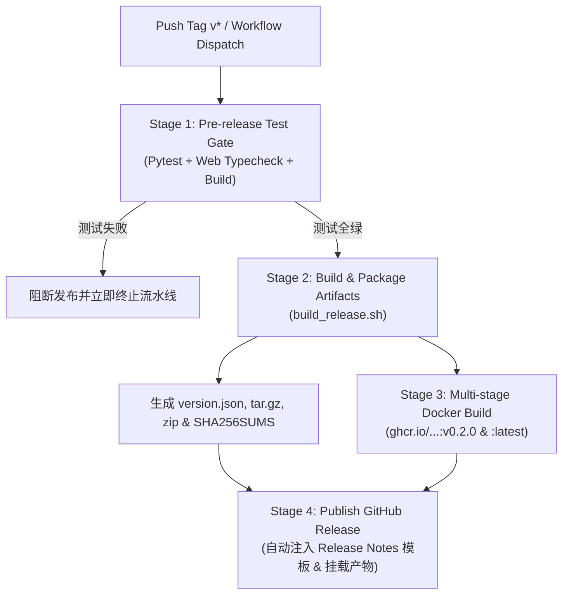

# Agent Fleet - 发布运维与版本回退操作指南 (Release & Rollback Runbook)

本指南面向 Agent Fleet 项目维护者与运维工程师，详述**集成发布流程、版本标签管理、自动化构建验证、发布产物指纹核验**，以及**生产发布异常时的应急回退与数据恢复机制**（关联 Issue #57 与 Issue #61）。

---

## 1. 发布原则与版本契约 (Release Principles & Versioning)

1. **语义化版本 (Semantic Versioning)**：
   - 遵循 `vMAJOR.MINOR.PATCH` 格式（如 `v0.2.0`）。
   - **MAJOR**：涉及不向后兼容的 API 变动或无法向前兼容的重大数据库结构破坏。
   - **MINOR**：新增向下兼容的功能模块、适配新的 Coding Agent、扩展管理命令。
   - **PATCH**：向下兼容的缺陷修复、探针健壮性优化、文档及构建补丁。
2. **构建可追溯性 (Build Traceability)**：
   - 每个正式发布产物内嵌包含精确 Git Commit SHA、Short Commit、UTC 构建时间戳及 `is_release: true` 的元数据声明 (`backend/agent_fleet/version.json`)。
   - 杜绝未打包或脱离 Git 树的“黑盒”构建，API 端点 `/api/system/version` 实时暴露此元数据。
3. **不可变发布产物 (Immutable Artifacts)**：
   - 每次发布生成独立的预编译压缩包（`agent-fleet-vX.Y.Z.tar.gz` 和 `.zip`）、多架构 Docker 镜像（`ghcr.io/...:vX.Y.Z`），以及对应的 SHA-256 校验和文件（`SHA256SUMS`）。
   - 产物一旦发布，严禁覆写对应标签内容。

---

## 2. 发布前自检清单 (Pre-Release Checklist)

在打标签与执行发布前，维护者必须逐项确认：

- [ ] **分支与工作区状态**：当前位于最新的 `main` 分支，工作区无未提交更改 (`git status --porcelain` 为空)。
- [ ] **全量自动化测试通过**：
  ```bash
  export PYTHONPATH=backend
  .venv/bin/python -m pytest tests/ -n auto --dist=loadscope
  ```
- [ ] **前端静态类型与打包检查**：
  ```bash
  cd web
  npm run typecheck
  npm run build
  cd ..
  ```
- [ ] **数据库版本与迁移自洽**：
  - 核查 `backend/agent_fleet/db.py` 中 `MIGRATIONS` 列表中的版本序号，确认新增字段或表迁移已包含在有序迁移清单中。
- [ ] **本地打包干跑验证 (Dry-Run)**：
  ```bash
  ./scripts/build_release.sh v0.2.0 --dry-run
  ```
  确认控制台输出包含 `✓ Standalone archive verification passed successfully` 且工作树无残留脏文件。

---

## 3. 版本标签创建与触发发布 (Tagging & Triggering Release)

### 3.1 标注标签创建与推送 (推荐方式)

发布必须使用 Git 标注标签（Annotated Tag）：

```bash
# 1. 检出最新 main 分支并拉取
git checkout main
git pull origin main

# 2. 创建附注标签（必须包含版本概要说明）
git tag -a v0.2.0 -m "Release v0.2.0: Multi-machine runner orchestration and telemetry"

# 3. 校验标签信息
git show v0.2.0

# 4. 推送标签到远程仓库（自动触发 GitHub Actions 发布流水线）
git push origin v0.2.0
```

### 3.2 手动触发发布工作流 (Workflow Dispatch)

若需要在未正式推 Tag 前验证完整流水线或在受控环境下手动发版：
1. 访问 GitHub 仓库的 **Actions** 页面。
2. 在左侧选择 **Release** 工作流。
3. 点击 **Run workflow**：
   - **Release tag**：输入目标标签（例如 `v0.2.0`）。
   - **Dry run**：勾选则仅构建与验证所有产物，跳过推送 GHCR 镜像及创建正式 GitHub Release。

---

## 4. 自动化流水线流转说明 (.github/workflows/release.yml)

自动化发布流水线严格遵循“先守门、再构建、再分发”的阶段性设计：



1. **Stage 1 (Test Gate)**：必须全量跑通后端 400+ 单元测试与前端类型检查；若有任何一项失败，立即失败阻断，绝不带病发版。
2. **Stage 2 (Integrated Packaging)**：执行 `scripts/build_release.sh`，生成内嵌元数据的轻量独立运行包与校验文件。
3. **Stage 3 (Docker Image)**：基于根目录 `Dockerfile` 进行两阶段构建，自动挂载预编译前端与 Python 运行时，推送到 `ghcr.io`（Dry-run 模式下只构建不推送）。
4. **Stage 4 (Release Notes & Publishing)**：聚合生成包含变更历史、破坏性变更声明、模式版本及回滚指南的 Release 发布页，并挂载压缩包与 SHA256 文件。

---

## 5. 产物校验与现场核验 (Artifact & Checksum Verification)

在正式宣布版本可用前，维护者需在独立干净环境执行现场核验。

### 5.1 校验和与完整性验证

```bash
# 1. 下载发布产物与校验和
curl -LO https://github.com/<owner>/agent-fleet-webui/releases/download/v0.2.0/SHA256SUMS
curl -LO https://github.com/<owner>/agent-fleet-webui/releases/download/v0.2.0/agent-fleet-v0.2.0.tar.gz

# 2. 执行 SHA-256 哈希比对
sha256sum -c SHA256SUMS --ignore-missing

# 预期输出：
# agent-fleet-v0.2.0.tar.gz: OK
```

### 5.2 独立解压运行验证

```bash
# 1. 解压独立包
tar -xzf agent-fleet-v0.2.0.tar.gz
cd agent-fleet-v0.2.0

# 2. 检查内嵌版本声明文件
cat backend/agent_fleet/version.json
# 预期输出形如：
# {
#   "version": "0.2.0",
#   "commit": "1e85816f79c64300972b8baa3a910bf656781cd7",
#   "commit_short": "1e85816",
#   "build_time": "2026-10-29T10:38:40Z",
#   "is_release": true
# }

# 3. 启动单机实例自测
./start.sh --port 8080 &
SERVER_PID=$!

# 等待启动并调用健康与版本接口
sleep 2
curl -s http://127.0.0.1:8080/api/system/version
# 预期返回 is_release: true, version: "0.2.0"

# 验证通过后停止自测服务
kill $SERVER_PID
```

### 5.3 Docker 容器镜像验证

```bash
docker pull ghcr.io/<owner>/agent-fleet-webui:v0.2.0
docker run --rm -d --name test-fleet -p 8080:8000 ghcr.io/<owner>/agent-fleet-webui:v0.2.0

# 校验 API 响应
curl -s http://127.0.0.1:8080/api/health
curl -s http://127.0.0.1:8080/api/system/version

docker stop test-fleet
```

---

## 6. 故障应急与版本回退操作指南 (Emergency Rollback Runbook)

当新版本上线后出现重大 Regression、数据兼容性异常或服务无法启动时，严格按本章节操作。

> [!IMPORTANT]
> 数据库降级回退核心技术细节与安全防护机制详见 [docs/recovery-guide.md](recovery-guide.md)（Issue #57 成果规范）。

### 6.1 升级前在线备份（黄金前提）

在对存量实例实施任何版本升级前，必须执行一次经过完整性校验的一致性热备份：

```bash
python -m agent_fleet.cli backup

# 记录备份生成的文件路径，例如：
# data/backups/fleet_backup_20261029_180000.db
```

### 6.2 独立安装包部署的回退步骤

若采用 Standalone Tarball 运行：

1. **停止当前新版本服务**：
   ```bash
   pkill -f "uvicorn agent_fleet.main:app" || true
   ```
2. **切回上一个稳定版本的安装目录**（如 `agent-fleet-v0.1.0/`）：
   ```bash
   cd /opt/agent-fleet-v0.1.0
   ```
3. **安全恢复升级前数据库快照**：
   ```bash
   # 执行受防倒灌与事务隔离保护的原子恢复
   python -m agent_fleet.cli restore /opt/agent-fleet/data/backups/fleet_backup_20261029_180000.db
   ```
   > [!NOTE]
   > `restore` 命令将自动执行：
   > 1. SHA-256 与 `PRAGMA integrity_check` 完整性校验；
   > 2. 检查 `backup.schema_version <= app.max_schema_version`（防止旧版本读高版本表引发崩溃）；
   > 3. 清理残留 `-wal` 和 `-shm`，避免旧日志重放造成页撕裂；
   > 4. 生成 `.pre_restore` 安全快照后原子置换主数据库。
4. **重新启动旧版本服务**：
   ```bash
   ./start.sh
   ```
5. **验证回滚后健康状态**：
   ```bash
   curl -f http://127.0.0.1:8000/api/system/version
   ```

### 6.3 容器化部署的回退步骤

若采用 Docker / Compose 部署：

1. **停止运行新版本容器**：
   ```bash
   docker stop agent-fleet
   ```
2. **将数据卷中的数据库恢复为备份版本**：
   ```bash
   # 临时挂载数据卷执行安全恢复
   docker run --rm \
     -v agent_fleet_data:/app/data \
     ghcr.io/<owner>/agent-fleet-webui:v0.1.0 \
     python -m agent_fleet.cli restore /app/data/backups/fleet_backup_20261029_180000.db
   ```
3. **重新使用上一稳定镜像标签启动容器**：
   ```bash
   docker rm agent-fleet
   docker run -d \
     --name agent-fleet \
     -p 8000:8000 \
     -v agent_fleet_data:/app/data \
     ghcr.io/<owner>/agent-fleet-webui:v0.1.0
   ```
4. **核验恢复后日志与接口**：
   ```bash
   docker logs agent-fleet --tail 50
   curl -s http://127.0.0.1:8000/api/health
   ```

---

## 7. 常见发布异常诊断 (Troubleshooting FAQ)

### Q1: `build_release.sh` 提示 `npm is required` 或前端构建失败
- **原因**：构建环境未安装 Node.js 或前端依赖未安装。
- **排查与解决**：
  在运行发版前先进入 `web` 目录执行 `npm ci`，确认 `npm run build` 无任何 TypeScript 报错。

### Q2: 校验和匹配失败 (`sha256sum: FAILED`)
- **原因**：压缩包在上传或下载过程中网络中断或存在代理篡改。
- **排查与解决**：
  重新下载并在本地重新运行 `compute_sha256` 核对，不可强行部署哈希不一致的归档包。

### Q3: `git push origin vX.Y.Z` 触发的 Actions 报 `Permission to ghcr.io denied`
- **原因**：工作流配置中缺少 `packages: write` 权限或仓库设置中未允许 GITHUB_TOKEN 读取与写入包。
- **排查与解决**：
  核验 `.github/workflows/release.yml` 的 `permissions:` 块是否包含 `packages: write` 和 `contents: write`，并在仓库 Settings -> Actions -> General -> Workflow permissions 中选择 “Read and write permissions”。
